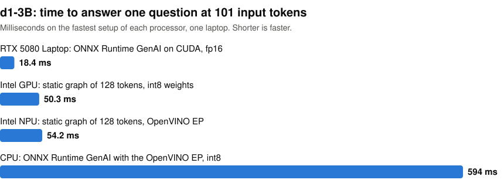

# d1-3B on a Windows laptop: CUDA, WebGPU, OpenVINO and the Intel NPU

[LiquidAI/d1-3B](https://huggingface.co/LiquidAI/d1-3B) reads text or images and answers questions about them with probabilities, in one forward pass and without generating text. This repo runs it on every processor of one Windows laptop and compares each result with the model's reference code from Hugging Face, in fp32.

<picture>
  <source media="(prefers-color-scheme: dark)" srcset="https://raw.githubusercontent.com/john-rocky/d1-on-windows/main/docs/images/decide-dark.svg">
  
</picture>

For example, given the text "I was charged twice this month, please refund one of them." and the question "Which team should handle this?", the reference code returns billing 0.98, technical 0.01 and fraud 0.01.

The fastest setup on each processor:

| Processor | Fastest setup at 101 tokens | Same top answer | Time at 39 / 101 / 467 input tokens, ms |
|---|---|---|---|
| RTX 5080 Laptop | ONNX Runtime GenAI on CUDA, fp16 | 415/415 | 15.7 / 18.4 / 64.8 |
| Intel GPU | OpenVINO Runtime, static graph of 128 tokens, int8 weights | 311/311 | 50.2 / 50.3 / — |
| Intel NPU | ONNX Runtime with the OpenVINO EP, static graph of 128 tokens | 311/311 | 54.2 / 54.2 / — |
| CPU | ONNX Runtime GenAI with the OpenVINO EP, int8 | 414/415 | 211 / 594 / 2305 |

Times are the median of 9 runs after one warm pass, one question per request. The test set is 415 text questions. The Intel GPU and NPU setups above use a graph of a fixed length, so they answer only the 311 questions that fit in 128 tokens. The same Intel GPU graph exported without `--fold` is 0.7 ms faster at 49.6 ms, but the top answer changes on 11 of the 311 questions, so the table leaves it out. Longer graphs, WebGPU and every other runtime and precision are in [the results](docs/results.md).

When the CPU row was timed again on 2026-11-11 in processes that opt out of Windows power throttling (High QoS in [the results](docs/results.md)), [3 of 36](results/speed_high_qos_1111_ov_evening.txt) ran 15 to 19 % slower than the others at both 39 and 467 tokens; the cause was not found. The table's times are the earlier published ones; two processes without that slowdown averaged 213 / 590 / 2391 ms, within 5 % of them.

The NPU is slower than the RTX but barely touches the CPU: system CPU use was 1.2 %, against 9.5 % with CUDA on the RTX.

For images with small print, the reference code does better than ONNX Runtime GenAI. GenAI resizes an image once, and the reference code cuts a large image into tiles. On 20 generated invoices, each with one multiple-choice question, the reference code got 20 right and GenAI 13.

## Run it

[The steps](docs/run-it.md) are PowerShell blocks to run in order. Each block builds the model for one processor and prints its score and times. They need Python 3.12, about 30 GB of disk next to the model folder, and a machine like this one with 32 GB of RAM. On this machine the CUDA block took 35 minutes and the NPU block 11 minutes.

To call a built model from your own code, start from [`d1-decisions.py`](https://github.com/microsoft/onnxruntime-genai/blob/v0.19.0/examples/python/d1-decisions.py), the ONNX Runtime GenAI script these runs import. The setups that failed and their error messages are in [What did not work](docs/what-did-not-work.md).

## The machine

MSI Stealth 16 AI+, Windows 11 build 26200, Core Ultra 9 386H, 31.5 GB of memory, RTX 5080 Laptop 16 GB, Intel Graphics and an Intel AI Boost NPU. Driver versions are in [the results](docs/results.md).

## License

The code here is under the Apache License 2.0. This repo holds no weights: d1-3B is under the [LFM Open License v1.0](https://huggingface.co/LiquidAI/d1-3B/blob/main/LICENSE).
